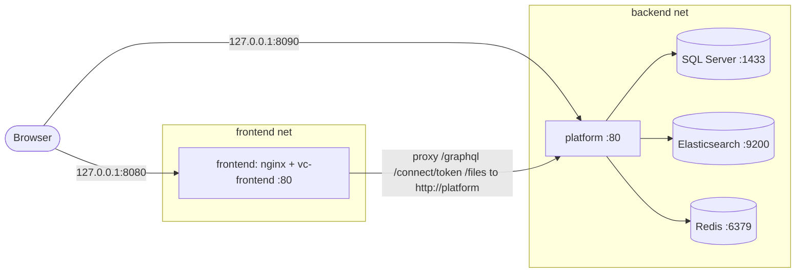
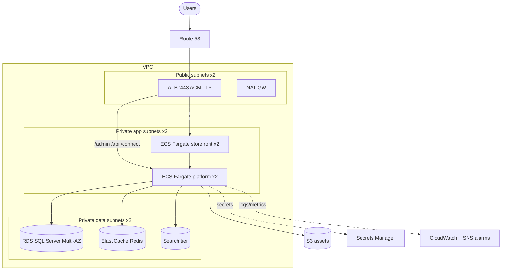

# Architecture (Task 1)

> **Three environments, never to be confused**
> | Environment | What it is | Status in this repo |
> |---|---|---|
> | **Local Docker** | The real Virto Commerce containers on Docker Compose | Configured; run it with `scripts/up.sh` and record evidence |
> | **Floci (emulated AWS)** | AWS-shaped API on `localhost:4566`; resources exist only in the emulator | IaC written (`terraform/envs/floci`); run it and record evidence |
> | **Real AWS** | Actual account, paid resources | **Design + IaC reference only. Never applied. No claim of a real deployment.** |

## 1. Responsibilities
- **Virto Commerce Platform** (.NET, image `virtocommerce/platform`): back-end and admin UI, modular. Owns catalog, orders, customers, pricing, security (OpenID/OAuth), the module system, search indexing, the REST/GraphQL (xAPI) endpoints and the `cms-content` (themes/pages) folder.
- **Frontend**: a pure API client of the Platform; it holds no business data. Two options exist:
  1. Legacy ASP.NET *Storefront* (`virtocommerce/storefront`), the image named in the assignment. **Tested and found incompatible** with the current Platform (see §6).
  2. The current Vue/TypeScript *vc-frontend* (B2B SPA, GitHub `VirtoCommerce/vc-frontend`). **This is what runs in this repo**: the pinned release is downloaded and served by nginx, which also proxies GraphQL to the Platform.

## 2. Dependencies (Platform)
| Dependency | Role | Local | Real AWS (proposed) |
|---|---|---|---|
| SQL Server (Virto also documents PostgreSQL/MySQL in newer releases) | Primary store, schema created by Platform migrations on first start | `mssql/server:2022` container, volume `mssql_data` | RDS for SQL Server, Multi-AZ, private subnets |
| Search (Elasticsearch / Azure Search / Lucene) | Catalog + order indexes | Elasticsearch 8.15.3 single node, security off (isolated network) | Elastic Cloud or self-managed ES on ECS/EC2. OpenSearch compatibility is **untested**, so it is not claimed. |
| Redis | Distributed cache / event bus between instances | `redis:7.4` with password + AOF | ElastiCache Redis, TLS, 2 nodes |
| File storage | Uploads in `App_Data`, themes in `cms-content` | Docker volumes | S3 (Platform asset provider) + EFS or baked theme for cms-content |

## 3. Images and versions (pin before demo)
| Component | Reference in `.env.example` | Note |
|---|---|---|
| Platform | `ghcr.io/virtocommerce/platform:3.1076.13` | **Must equal the `PlatformVersion` of the module bundle** (`bundles/latest`, bundle 16.0.13). Docker Hub `:latest` was 3.1101, *newer* than the stable bundle, and the 3.1076.13 tag exists only on ghcr.io. Digest recorded in `evidence/image-versions.txt`. |
| Modules | 59 modules from bundle `latest` | Installed once by `scripts/install-modules.sh` (one-shot `vc-build` job, `dotnet/sdk:10.0`) into volume `platform_modules`. The platform image itself contains **no modules and no admin UI**. |
| Frontend | `vc-frontend` **2.59.1** + `nginx:1.30.7-alpine` | Version comes from the same bundle (`ThemeB2BVue`); `scripts/fetch-frontend.sh` downloads it. |
| Legacy storefront | `virtocommerce/storefront:latest` | Image built **2024-04-18**. Kept only behind compose profile `legacy` as evidence. See §6. |
| SQL Server | `mcr.microsoft.com/mssql/server:2022-latest` | pin to a CU tag for production |
| Elasticsearch | `docker.elastic.co/elasticsearch/elasticsearch:8.15.3` | Platform's ES provider runs with `EnableCompatibilityMode` |
| Redis | `redis:7.4-alpine` | |
| Floci | `floci/floci:latest` | pin a release tag |

Compatibility assumptions (now **verified by running**): module bundle, platform and vc-frontend must come from the same release set; Elasticsearch 8.x with the `ElasticSearch8` provider (`EnableCompatibilityMode=true`); SQL Server via `DatabaseProvider=SqlServer`. The legacy storefront does *not* work with this platform (§6).

## 4. Container communication and ports

Only `platform:80` and `frontend:80` are published, bound to `127.0.0.1`. SQL Server, Elasticsearch and Redis publish nothing. `scripts/validate.sh` asserts host ports 1433/9200/6379 are closed. The frontend is only on the `frontend` network and has no route to the data tier.

## 5. Persistence and configuration
- Volumes: `mssql_data`, `es_data` (rebuildable by reindexing), `redis_data`, `platform_appdata` (uploads, license), `platform_modules` (installed modules), `cms_content` (themes/pages).
- Configuration is by environment variables (`.env`, template `.env.example`). ASP.NET Core maps `A__B__C` to `A:B:C`, so compose overrides `appsettings.json`. Secrets are generated by `scripts/generate-env.sh`; `.env` is git-ignored.

## 6. Frontend choice, and implications of an older image
**Chosen: `vc-frontend` 2.59.1.** The assignment names `virtocommerce/storefront`, so it was tried first, and it **failed against Platform 3.1076.13**:
the image (built 2024-04-18) logs in successfully, then calls `GET /api/stores`, which the Platform answers **405 Method Not Allowed**; every page returns HTTP 500 while the container still reports *healthy* (TCP-only healthcheck). Details and commands: `docs/TROUBLESHOOTING.md` (worked example), evidence `evidence/08-frontend-platform-comms.txt`.
- *Compatibility*: legacy storefront = old REST API; current Platform = GraphQL (xAPI). Pairing it would require pinning a Platform from its era (2024), which would no longer match the current module bundle.
- *Maintenance*: the legacy image has had no upstream rebuild for ~2 years; no fixes against new base images.
- *Security*: it runs an out-of-support .NET runtime and unpatched base layers. It is therefore **not started by default** (profile `legacy`), bound to localhost only, and has no data-tier access.
- *Why vc-frontend*: actively released, built for the current Platform, same release set as the modules. Trade-off: a static SPA needs a web server (nginx) and a reverse proxy for `/graphql`, `/connect/token`, `/files`, `/cms-content`, `/hub`. In AWS this maps to CloudFront/S3 or an nginx task behind the ALB.

## 7. Proposed real-AWS architecture (not deployed)

Why ECS Fargate: stateless containers already exist, no hosts to patch, native ALB/IAM/Secrets integration, circuit-breaker rollback. EC2 would be chosen only if the platform needed host-level tuning or persistent local disks. The Platform needs care when scaling beyond one task (shared Redis, shared file storage for `App_Data`, module installation done at image build time rather than at runtime).

## 8. Local development with Floci
`docker-compose.floci.yml` runs Floci on `:4566`; `terraform/envs/floci` provisions a VPC with 3 subnet tiers, security groups, two S3 buckets, a Secrets Manager secret, log groups, a least-privilege IAM role and an ECS cluster. The application stack runs separately in plain Docker Compose; **Floci does not run Virto and nothing here proves AWS compatibility of the app.**

## 9. Emulator vs real AWS
| Topic | Floci | Real AWS |
|---|---|---|
| Credentials | accepts dummy `test/test` | IAM identities, SigV4, MFA, SCPs |
| ECS/EC2/RDS | run as Docker containers on your machine | managed Fargate/EC2/RDS with real networking |
| Networking | VPC/SG objects are metadata; they enforce nothing | real isolation, routing, NAT, endpoints |
| ALB / ACM | API-level object only, no real TLS termination | real TLS, WAF, health-check-driven routing |
| Limits/quotas, pricing, KMS rigour, CloudWatch alarms firing | not faithful | authoritative |
| API parity | broad (project advertises 100+ services) but operation coverage varies | complete |

Floci emulates many services including ECS, RDS, ELBv2, EC2, IAM, Secrets Manager and CloudWatch Logs/Metrics; the emulator is not billing- or security-faithful. Anything created there proves syntax and wiring of IaC only.
